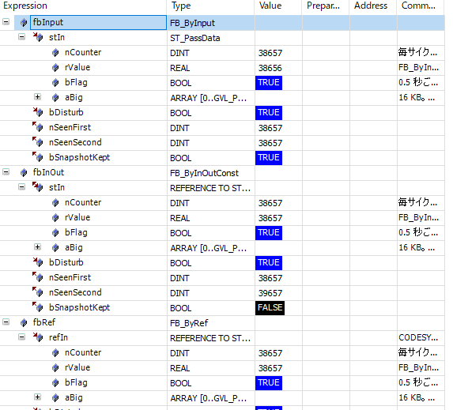
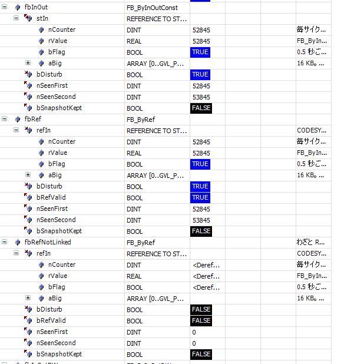
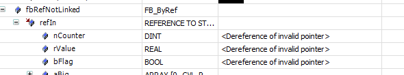
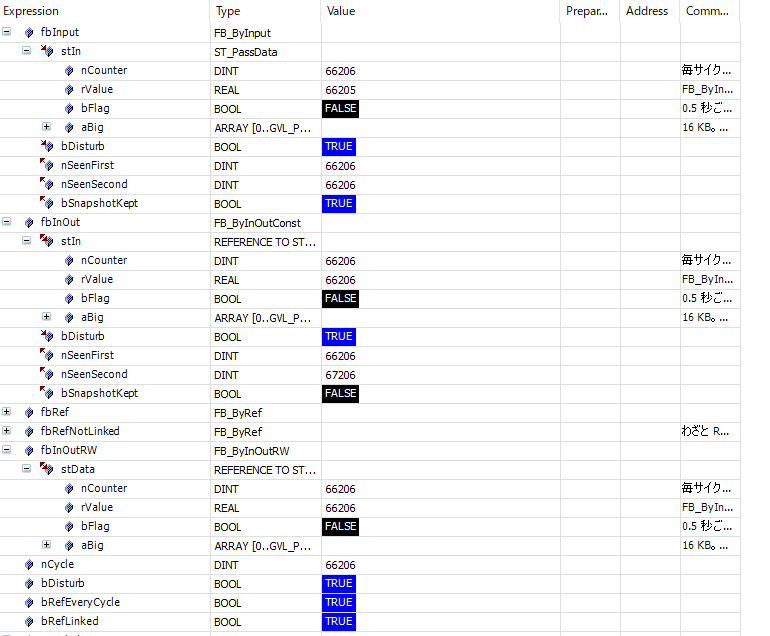
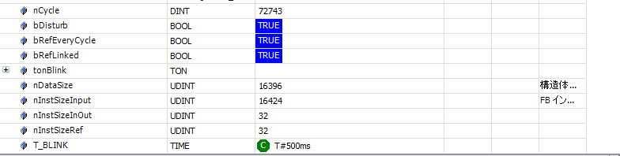
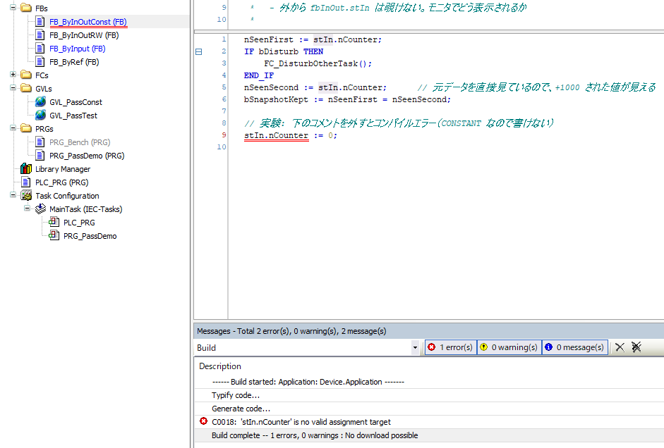
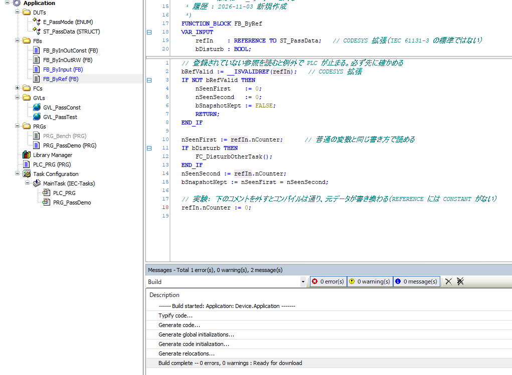
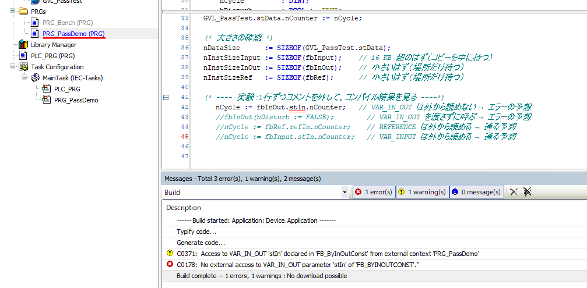
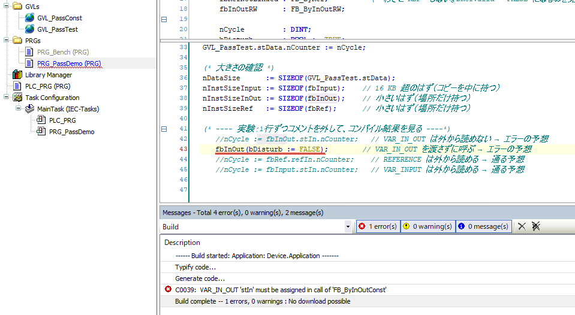
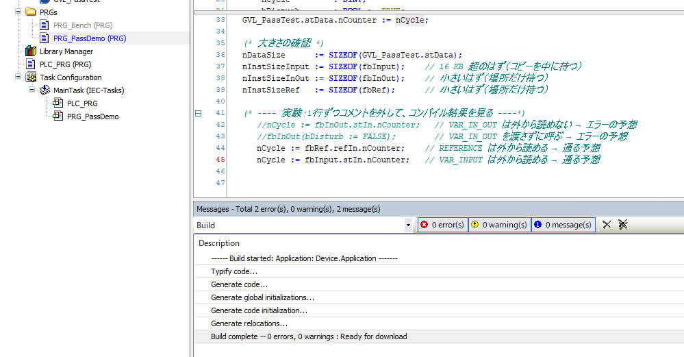

# codesys-pass-demo

構造体を FB に渡す 3 つの方法を、1 つのプロジェクトで見比べる確認用サンプル。

| 渡し方 | 中身 | FB |
|---|---|---|
| `VAR_INPUT` | 呼ぶたびにコピー | `FB_ByInput` |
| `VAR_IN_OUT CONSTANT` | 場所を渡す・読むだけ | `FB_ByInOutConst` |
| `REFERENCE TO`（CODESYS 拡張） | 場所を `REF=` で登録 | `FB_ByRef` |
| `VAR_IN_OUT`（CONSTANT なし） | 場所を渡す・書ける（悪い例） | `FB_ByInOutRW` |

一番の目的は **オンラインのモニタで、それぞれがどう見えるか** を確かめること。

## ファイル

```
codesys/src/
  GVL_PassConst.st        定数（配列の大きさ、ループ上限）
  ST_PassData.st          渡す構造体（小さいメンバー + 16 KB の配列）
  E_PassMode.st           ベンチマークのモード
  GVL_PassTest.st         元データ（全 FB がこれを見る）
  FC_DisturbOtherTask.st  「処理の途中で別タスクが書き換えた」を再現する
  FB_ByInput.st
  FB_ByInOutConst.st
  FB_ByInOutRW.st
  FB_ByRef.st
  PRG_PassDemo.st         3 つを同じ条件で並べて呼ぶ（モニタ確認用）
  PRG_Bench.st            処理時間を比べる
```

## CODESYS の設定

1. 新規プロジェクト（標準プロジェクト、デバイスは CODESYS Control Win V3）を作り、`codesys/src` の ST を取り込む
   - [codesys-st-sync](../codesys-st-sync) を使うか、各ファイルを貼り付け
   - 取り込む順番の目安：GVL_PassConst → ST_PassData → E_PassMode → GVL_PassTest → FC → FB → PRG
2. タスク設定
   - `MainTask`（周期 10ms）に `PRG_PassDemo`
   - タスクを1つ追加して `BenchTask`（周期 100ms、優先度は MainTask より低く）に `PRG_Bench`
3. ビルド → ログイン → Run

Modbus の設定は不要。

## 確認 1：モニタでの見え方（PRG_PassDemo）

オンラインで `PRG_PassDemo` を開き、各インスタンスの「＋」を展開する。
次の表の「実際の表示」欄を埋めていくと、違いが整理できる。

| 見る場所 | 予想 | 実際の表示（Control Win V3 で確認） |
|---|---|---|
| `fbInput.stIn` | 構造体として展開でき、中身が見える | 型は `ST_PassData`。展開でき、中身が見える |
| `fbInOut.stIn` | アドレス表示か、参照先の中身が展開できるか | 型は **`REFERENCE TO ST_PassData`** と表示。参照先の中身まで展開できる |
| `fbRef.refIn` | 同上 | 型は `REFERENCE TO ST_PassData`。参照先の中身まで展開できる |
| `fbRefNotLinked.refIn` | 無効な参照の表示 | 展開はできるが、値の欄は **`<Dereference of invalid pointer>`** |
| `fbInOutRW.stData` | `fbInOut.stIn` と同じ見え方 | 型は `REFERENCE TO ST_PassData`。参照先の中身まで展開でき、`fbInOut.stIn` と同じ見え方（型欄の見えている範囲では、CONSTANT の有無は区別がつかない） |









### 分かったこと

- **VAR_IN_OUT は、中身としては REFERENCE TO と同じ扱い。** モニタの型欄にも `REFERENCE TO` と出る。だから参照先まで展開できる
- **モニタに出る値の意味が違う。**
  - VAR_INPUT（`fbInput.stIn`）：FB が呼ばれた時点で受け取った値（コピー）
  - VAR_IN_OUT / REFERENCE：モニタが読みに行った瞬間の、元データの今の値
  - 実例：`rValue` は同じサイクルの最後に `fbInOutRW` が +1 する。`fbInput.stIn.rValue` は +1 される前の値（38656）、参照の 2 つは +1 された後の今の値（38657）が見えた
- **参照のモニタには、FB が処理中に見た値は出ない。** `fbInOut.stIn.nCounter` は 38657 と表示されたが、FB は処理の途中で 39657 を見ていた（`nSeenSecond`）。処理中の値を追いたいなら、FB の中で出力変数に写しておく
- **登録されていない参照は `<Dereference of invalid pointer>` と表示される。** モニタでこれが見えたら、REF= のし忘れのサイン。型は決まっているのでメンバー一覧は展開できる
- `__ISVALIDREF` で確かめて `RETURN` しているので、無効な参照があっても PLC は止まらなかった（`bRefValid` = FALSE、出力は 0）

ウォッチリストに入れて比べるのもおすすめ（表示 → ウォッチ → ウォッチ 1 に変数名を入力）:

```
PRG_PassDemo.fbInput.stIn.nCounter
PRG_PassDemo.fbInOut.stIn.nCounter
PRG_PassDemo.fbRef.refIn.nCounter
GVL_PassTest.stData.nCounter
```

2 行目は、ウォッチリストで外から VAR_IN_OUT を指定できるかどうかの確認も兼ねている。

## 確認 2：途中で書き換わったら（bDisturb）

`bDisturb = TRUE`（初期値）のとき、各 FB は処理の途中で `FC_DisturbOtherTask` を呼び、元データの `nCounter` を +1000 する。

| インスタンス | nSeenFirst | nSeenSecond | bSnapshotKept | 意味 |
|---|---|---|---|---|
| `fbInput` | nCycle | nCycle | TRUE | コピーなので影響を受けない |
| `fbInOut` | nCycle | nCycle + 1000 | FALSE | 元データを直接見ている |
| `fbRef` | nCycle | nCycle + 1000 | FALSE | 同上 |
| `fbRefNotLinked` | 0 | 0 | FALSE | 参照が無効なので何もしない（bRefValid = FALSE） |

Control Win V3 で動かしても、この表のとおりになった（`fbInput` は TRUE、`fbInOut` と `fbRef` は FALSE で nSeenSecond が +1000、`fbRefNotLinked` は 0 / 0 / FALSE）。

`bDisturb` を FALSE に書き換えると（モニタで値を入れて Ctrl+F7）、全員 TRUE になる。

## 確認 3：書き換えられる危険（FB_ByInOutRW）

- `GVL_PassTest.stData.rValue` が、毎サイクル +1 されていく
- `PRG_PassDemo` は rValue を一度も書いていない。書いているのは FB の中
- 「入力のつもりで VAR_IN_OUT に渡したら、中身を変えられていた」がこれ。入力として渡すなら `CONSTANT` を付ける

結果：Control Win V3 で、`rValue` が毎サイクル増えていくのを確認した。

## 確認 4：大きさ（SIZEOF）

`PRG_PassDemo` の次の変数を見る。

| 変数 | 予想 | 結果 [byte] |
|---|---|---|
| `nDataSize` | 16 KB 強（16384 + 小さいメンバー分） | **16396** |
| `nInstSizeInput` | `nDataSize` より大きい（コピーを中に持つ） | **16424** |
| `nInstSizeInOut` | 数十バイト程度（場所だけ持つ） | **32** |
| `nInstSizeRef` | 数十バイト程度（場所だけ持つ） | **32** |



内訳の読み方（推定）:

- `nDataSize` = 16396：`aBig` 16384 + `nCounter` 4 + `rValue` 4 + `bFlag` 1 = 16393。残り 3 バイトは、配列を 4 バイト境界にそろえるための詰め物（パディング）と思われる
- `nInstSizeInput` = 16424：構造体のコピー 16396 が丸ごと入り、残り 28 バイトが FB 自身の変数（`bDisturb`、出力など）と管理情報
- `nInstSizeInOut` / `nInstSizeRef` = 32：中にあるのは参照先の場所（64 ビット環境なら 8 バイト）と FB 自身の変数だけ。16 KB を扱っていても 32 バイト

コピー渡しは、インスタンスを 1 つ作るたびに 16 KB ずつメモリを使う。参照渡しは何個作っても 32 バイトずつ。

## 確認 5：コンパイルエラーになるもの

1 行ずつコメントを外してビルドし、結果を確かめる。確かめたら元に戻す。

| 場所 | 行 | 予想 | 結果 |
|---|---|---|---|
| `FB_ByInput` | `stIn.nCounter := 0;` | 通る（FB 内のコピーだけ変わる） | **通る** |
| `FB_ByInOutConst` | `stIn.nCounter := 0;` | エラー（CONSTANT） | **エラー** `C0018: 'stIn.nCounter' is no valid assignment target` |
| `FB_ByRef` | `refIn.nCounter := 0;` | 通る（元データが変わる） | **通る**。VAR_INPUT でも、参照先には書き込めてしまう |
| `PRG_PassDemo` | `nCycle := fbInOut.stIn.nCounter;` | エラー（VAR_IN_OUT は外から読めない） | **エラー** `C0178: No external access to VAR_IN_OUT parameter 'stIn' of 'FB_BYINOUTCONST'.`（警告 `C0371` も出る） |
| `PRG_PassDemo` | `fbInOut(bDisturb := FALSE);` | エラー（VAR_IN_OUT の渡し忘れ） | **エラー** `C0039: VAR_IN_OUT 'stIn' must be assigned in call of 'FB_ByInOutConst'` |
| `PRG_PassDemo` | `nCycle := fbRef.refIn.nCounter;` | 通る | **通る**（0 errors, 0 warnings） |
| `PRG_PassDemo` | `nCycle := fbInput.stIn.nCounter;` | 通る | **通る**（0 errors, 0 warnings） |

REFERENCE TO を VAR_INPUT に置いても、「入力」になるのは参照先の場所だけで、データの中身は読み書きできる。読むだけのつもりで渡すなら VAR_IN_OUT CONSTANT のほうが安全。

`PRG_PassDemo` の 4 行はブロックコメント `(* ... *)` の中にあるので、1 行ずつブロックの外にコピーして試す。











モニタでは `fbInOut.stIn` を参照先の中身まで展開して見られた（確認 1）のに、コードからは読めない。モニタはデバッグ用の機能なので、コードの規則とは別に覗けるものと思われる。

## 確認 6：REF= を1回だけにしたら（bRefEveryCycle）※今回は実施していない

目的：REFERENCE TO を「最初に1回だけ REF= する」書き方が、オンライン変更で壊れないかを確かめる。

- オンライン変更で構造体にメンバーを足すと、変数のメモリ上の位置が変わることがある
- 1回だけ登録した参照は、古い場所を指したままになるおそれがある。参照は空ではないので `__ISVALIDREF` は TRUE のまま。エラーを出さずに、関係ないメモリを読み続けるかもしれない
- 確かめる場合は、`bRefEveryCycle` を FALSE にしてから `ST_PassData` の先頭にメンバーを足し、オンライン変更でログインする。`fbRef.nSeenFirst` が `nCycle` と一致するかを見る
- VAR_IN_OUT は呼ぶたびに場所を渡し直すので、この問題は起きない

## 確認 7：処理時間（PRG_Bench）

1. タスク設定を開き、「モニタ」タブで `BenchTask` の最終／平均の周期時間を表示する
2. オンラインで `PRG_Bench.eMode` を書き換えて切り替える

| eMode | 予想 |
|---|---|
| NONE | 基準（ほぼ 0） |
| BY_INPUT | 16 KB × nCalls 回のコピーで、はっきり増える |
| BY_INOUT | NONE とほぼ同じ |
| BY_REF | NONE とほぼ同じ |

### 結果（Control Win V3、BenchTask の周期時間 [µs]）

| eMode | nCalls | 平均 | 最大 |
|---|---|---|---|
| NONE | – | 6 | 15 |
| BY_INPUT | 10 | 18 | 39 |
| BY_INPUT | 1000 | 420 | 1492 |
| BY_INOUT | 10 | 6 | 16 |
| BY_INOUT | 1000 | 23 | 94 |
| BY_REF | 10 | 6 | 14 |
| BY_REF | 1000 | 27 | 62 |

1 回あたり（1000 回の平均から NONE の 6 µs を引いて 1000 で割る）:

| 渡し方 | 1 回あたり |
|---|---|
| BY_INPUT | 約 0.41 µs（16 KB のコピー 1 回分） |
| BY_INOUT | 約 0.017 µs |
| BY_REF | 約 0.021 µs |

分かったこと:

- コピー渡しは参照渡しの約 20 倍重い。BY_INPUT だけが回数に比例して増えた
- VAR_IN_OUT と REFERENCE はほぼ同じ。残る 20 ns 前後は FB を呼ぶこと自体の手間と思われる
- ただし絶対値は小さい。16 KB のコピー 1 回で約 0.4 µs、10 ms のタスクで毎サイクル 100 回コピーしても約 40 µs（周期の 0.4%）
- 10 回では差よりもぶれが目立つ。比べるなら回数を多くする
- 最大値は Windows の影響でぶれるので、平均で比べる
- 毎回同じデータを読んでいてキャッシュに乗っているため、速く出ている可能性がある。組み込みの実機 PLC では、もっと遅くなるかもしれない

- `nCalls` を 10 / 100 / 1000 と変えると、BY_INPUT だけが比例して増えるはず
- Control Win は Windows の上で動くので、値はぶれる。平均で比べる
- 周期時間が 100ms を超えるとタスクがあふれるので、`nCalls` は小さいほうから試す
